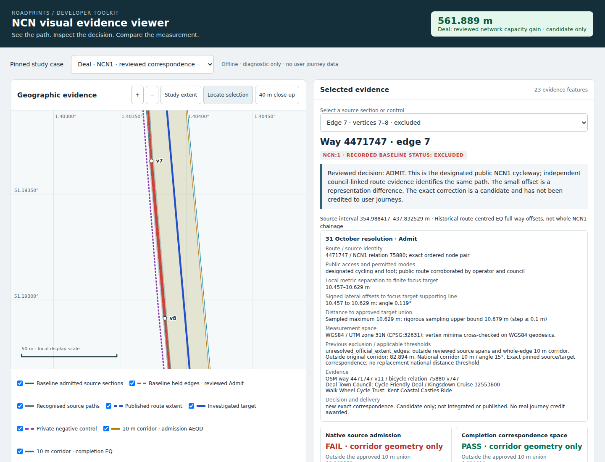

# Deal NCN1: route correspondence resolved

31 October 2026. **Decision: Admit all five held cycleway edges, 6–10, through an explicit reviewed correspondence. Exclude private residential way 77611523.** Implemented as an opt-in offline candidate, awaiting PR review/integration and separate publication. No user journey has received credit.

The publisher's route and OSM cycleway 4471747 identify the same eligible NCN1 route. This is an evidence-based route-identity conclusion; it does not establish which line is surveyed-accurate. The previous investigation correctly reproduced the existing rejection but treated that rule failure as the reason to retain it. The new independent route evidence supports a narrowly pinned exception rather than another projection change.

## Identity, access and connectivity

Fresh bounded OSM API evidence on 31 October reproduces all fourteen source coordinates/nodes exactly: way **4471747 v11**, `highway=cycleway`, `bicycle=designated`, `foot=designated`, asphalt, with no private/conditional restriction. It is a direct empty-role member of bicycle **relation 75880 v747**, NCN1 Dover–Canterbury. Hiking relations 8864 and 11738490 independently include it. The same tags and way membership apply to each of the five complete node-to-node edges; there is no internal access or identity split. Ordered nodes connect continuously, with admitted neighbours **84079387** at north node **978142881**, and **84079705** at south node **913199040**.

Independent primary sources corroborate the identity and public cycling route:

- [Walk Wheel Cycle Trust: Kent Coastal Castles Ride](https://www.walkwheelcycletrust.org.uk/find-a-route-on-the-national-cycle-network/kent-coastal-castles-ride/) identifies NCN1 through Walmer, Wellington Parade and Kingsdown for cycling and walking.
- [Deal Town Council: Cycle Friendly Deal](https://www.deal.gov.uk/Cycle_Friendly_Deal_34792.aspx) identifies the traffic-free seafront route and links [Kingsdown Cruise, route 32553600](https://ridewithgps.com/routes/32553600). Its coordinates follow this OSM cycleway; its directions place riders on the shared path beside gravel Wellington Parade and then into Boundary Road. This distinguishes the cycleway from the private carriageway.
- [White Cliffs Countryside Partnership](https://www.whitecliffscountryside.org.uk/visit-us/kingsdown-and-walmer-beach) describes the public beach corridor, NCN1 and a parallel coast footpath. That description is not evidence that every parallel path has the cycleway's identity or permissions.

The bounded OSM map has one designated cycleway here, the parallel private residential road, and Cecil Road at the northern edge of the study. Absence of another mapped cycleway alone would not establish correspondence; the membership, exact node chain, public operator/council evidence and council-linked route jointly do so. Static evidence supports this reference candidate, not historical access certification for every past date.

Evidence is compactly retained in [observations.json](../tests/fixtures/ncn-deal-resolution/observations.json), with source URLs, versions, raw-response SHA-256 values, extracted geometries and paraphrased factual instructions. No private journey data is used.



## Edge-by-edge verdict and measurements

Local distances use **WGS84 / UTM zone 31N (EPSG:32631)**. Independent WGS84 geodesic minimisation agrees with the five shared vertex minima within **0.002551 m**. These local ground measurements are deliberately separate from the preserved route-wide EQ source/target storage stationing.

| Source edge | OSM nodes | Local lateral offsets to focus target's supporting line | Alignment angle | Source length outside original admission corridor | Verdict |
| --- | --- | ---: | ---: | ---: | --- |
| 6 | 978142885 → 978142886 | 8.564–10.457 m | 1.331° | 18.681 m | **Admit** |
| 7 | 978142886 → 978142887 | 10.457–10.629 m | 0.119° | 82.894 m | **Admit** |
| 8 | 978142887 → 978142888 | 10.545–10.629 m | 0.031° | 157.641 m | **Admit** |
| 9 | 978142888 → 978142889 | 10.400–10.545 m | 0.093° | 89.027 m | **Admit** |
| 10 | 978142889 → 978142890 | 8.395–10.400 m | 0.761° | 28.364 m | **Admit**, across the focus target and its adjoining published target |
| 0–5 | Exact pinned node pairs retained in receipt | Already admitted | Unchanged | Existing approved spans | **Admit**, retain existing bindings |
| 11–12 | 978142890 → 27411872 → 913199040 | Already admitted source; completion remains finite/direction-limited | Unchanged | Existing approved span | **Admit as source**, retain existing bindings |
| Private 77611523 | Separate full node chain | Local finite minimum about 10.58 m | Irrelevant to entitlement | Different source identity | **Exclude**, private residential way without NCN1 membership |

Finite closest-point minima for edges 6–10 are respectively **8.564, 10.457, 10.545, 10.400 and 9.932 m**. Their finite-target endpoint maxima are **10.457, 10.629, 10.629, 10.545 and 116.064 m**. Edge 10's 116 m value is an endpoint/extent effect: the source continues south beyond this target into the adjacent legitimate target. Its lateral offset is about 10 m, not 116 m. The machine receipt records both quantities and the source's along-target projection, preventing that conflation.

All five old failures have the same two causes: `unresolved_official_extent_edges`, with edges outside the old reviewed source span list, and nonzero whole-edge length outside the original 10 m approved buffer. **No identity, public-access, cycling-permission or direction failure is established for these five edges.** Their small, continuous separation and close alignment are consistent with different representations of the same route. National 10 m/15° rules are unchanged.

Full-input verification inspected **3,761** original NCN1 features, including **2,533** nonapproved features; the nearest excluded geometry is **251.270 m** away (FID 19309). The complete reviewed target graph contains **31,194** edges. It confirms every candidate near the held span is present in the compact fixture and the reviewed junction has degree two. The original national snapshot and the later reviewed catalogue extent have different GlobalID metadata; authoritative target geometry/keys use the separately pinned reviewed extent, without inventing a common version. See [full-extent-check.json](../tests/fixtures/ncn-deal-resolution/full-extent-check.json).

## Implemented correction

[scripts/ncn_deal_correspondence.py](../scripts/ncn_deal_correspondence.py) consumes [review.json](../tests/fixtures/ncn-deal-resolution/review.json). It requires the exact validated ordinary-seam candidate content hash, prior bindings hash, source way/route/hash/nodes/coordinates/modes, observed access and relation evidence, complete-extent receipt, and both exact target lengths/coordinates/network mappings. Changed or unrelated evidence fails closed. It copies to a fresh output; it cannot modify the input or overwrite an existing candidate.

The exception is **exact reviewed route correspondence**, not an increased distance radius. Six finite affine bindings are added for source edges 6–10. Existing 10 m/15° completion gates produce the ordinary clipped mappings. At the shared published target vertex, a **0.028381 m** automatic ambiguity would remain: the closest-source projection of the target junction lies outside that tiny automatically ambiguous window. The explicit review instead pins that one target junction to full-way source station **719.4600679694057 m**, supported internally on source edge 10 at **9.189184562566632 m** in the preserved EQ space. Incoming and outgoing mappings meet there, with no overlapping source ownership or endpoint extrapolation. This does not modify the validated national seam algorithm.

All old bindings, including this source's two previous seam additions, remain byte-for-byte in order. The existing source, walking reference, bicycle graph, modes, target geometry, route lengths, network mappings, masks and all other path rows are preserved. No matcher code or automatic capture/journey editing changes. The private road cannot qualify by proximity, and no identity is aliased.

## Exact distance effect

Measured against the **validated seam candidate**, not against the older shipped catalogue:

| Measure | Before | Candidate | Increase |
| --- | ---: | ---: | ---: |
| Two affected targets: combined route-local assessability | 53.395477057653 m | 614.988688624392 m | **561.593211566739 m** |
| Affected canonical network union | 53.423856801318 m | 615.312593335812 m | **561.888736534494 m** |
| Original focus target, length 495.388143301922 m | 49.589559392026 m | 495.388143301922 m | **445.798583909896 m** |
| Adjoining target | 3.805917665627 m | 119.600545322470 m | **115.794627656843 m** |

All target/network denominators are unchanged. Applying the independently measured local union delta to the pinned national seam receipt gives **16,146,369.976629720 m** assessable, **1,288,762.517376248 m** unbound, **92.608243626372%**, out of **17,435,132.494005967 m**. This is arithmetic from the fully validated prior candidate plus the isolated measured delta, not a fresh national source reassessment. Neither NCN1 nor the network becomes 100% attainable.

The five held edges and original 495.388 m target are resolved. A separate **3.243944230930 m** at the far end of the adjoining 122.844 m target remains outside the retained finite/direction correspondence. It is beyond the reviewed held-edge interval; no credit is inferred from it. Existing admitted source edge 12 turns away from this target's direction. Resolving that next corner would require a distinct endpoint/junction correspondence review; it is not a reason to hold the five verified edges or to credit the corner speculatively.

Shared walking/cycling physical coverage increases by **0 m**: the physical cycleway was already represented. This correction increases NCN attribution capacity only. Actual user completion change is **0 m** in this task: no publication, journey assessment or retrospective award occurs.

## Validation and viewer

An independent read-back of **1,376,616 rows** finds exactly one changed row: `paths / NCN:1 / 4471747`. Every other row, schema, target, length, mapping and existing source field/binding is preserved. Thirty independent finite-anchor/interpolation checks pass; maximum stored EQ source-target anchor distance is **9.83213585822932 m**. A second implementation independently recomputes local/unique-network before/after unions, including all other routes sharing affected canonical edges, and agrees exactly. Source ownership, modes, access/identity mutations, private negatives, finite extents and deterministic receipts are covered.

The [offline viewer](ncn-viewer/demo/index.html) retains baseline operational decisions and adds the 31 October verdict, source/node/route identity, public access/cycling evidence, local separation, alignment, old exclusion cause and applicable thresholds. All eight original cases remain. **114 offline Chromium checks pass**, zero network requests/page exceptions, including all five selected sections and mobile overflow. The historical baseline colouring is explicitly labelled; the new candidate decision is separate. The hosted viewer is not redeployed.

Final validation: **413 local Python tests**, zero failures/errors/skips; **114 offline browser checks**; and **45 candidate-specific Android tests**, zero failures/errors/skips. [Dedicated CI run 41184546990](https://github.com/adamdbird-gfc/uk-road-tracker/actions/runs/41184546990) passed on implementation commit `d2c9d4cf01102f1fe1abf5b0b1e0791a7d042d36`, including immutable cache restoration, exact candidate reproduction, byte-identical independent audit receipt, every national target-to-network mapping and existing consumer/seam regressions. The separate NCN local trial CI also passed. The later delivery-only commit adds this validation record and screenshot; implementation and generated viewer bytes are unchanged. Physical phone acceptance and any future reference publication remain separate gates.

## Reproduce

```sh
python -m pip install -r requirements-ncn-deal.txt
python -m scripts.reproduce_ncn_ordinary_seams --database SHIPPED_DB --output /tmp/deal-seam.db
python -m scripts.ncn_deal_correspondence --database /tmp/deal-seam.db --output /tmp/deal-candidate.db
python -m scripts.inspect_ncn_deal_resolution --before /tmp/deal-seam.db --after /tmp/deal-candidate.db --output /tmp/deal-audit.json
cmp /tmp/deal-audit.json docs/data-trials/ncn-deal-resolution-20261031.json
python -m scripts.verify_ncn_deal_extent --checkpoint CHECKPOINT_ROOT --output /tmp/deal-extent.json
cmp /tmp/deal-extent.json tests/fixtures/ncn-deal-resolution/full-extent-check.json
PYTHONPATH=.:tests python -m unittest scripts.test_ncn_deal_correspondence -v
PYTHONPATH=. python docs/ncn-viewer/generate.py
PYTHONPATH=.:tests python docs/ncn-viewer/test_viewer.py -q
node docs/ncn-viewer/browser-test.cjs
```

Original shipped DB SHA-256: `973ad286cffbec67fa3249b7d00b3a201059ac552aac6b63b577bb5db5637093`. Required seam candidate content SHA-256: `cf25e006e79782c9458895bf4b68179b7829fe3b6e7d5ded96be0ccd07929dc0`. Original archives were restored without Firebase downloads. The committed exception and proof are small; no new national DB is committed.

## Delivery state

Source branch `fix/ncn1-deal-correspondence-20261031`, directly from main `40f3c0d00e171800a157af4b3db5d4125134203b`; [PR #254](https://github.com/adamdbird-gfc/uk-road-tracker/pull/254) targets main and remains open/unmerged. Scope checkpoint `cde040f88e83dc957d4d603a923d480427f7bec0` independently fetched back. #242/#247 findings and seam corrections preserved. Exact #249 viewer source is carried forward with the requested improvements; #248/#249/#251 remain unmerged. No integration, deployment, Firebase change, hosted-viewer update, APK build/distribution, production modification or issue closure. Installed APK/live backend/active Firebase pins remain unknown; archived bytes are not a live-state claim. Android journey split/join stays separate under #253.
